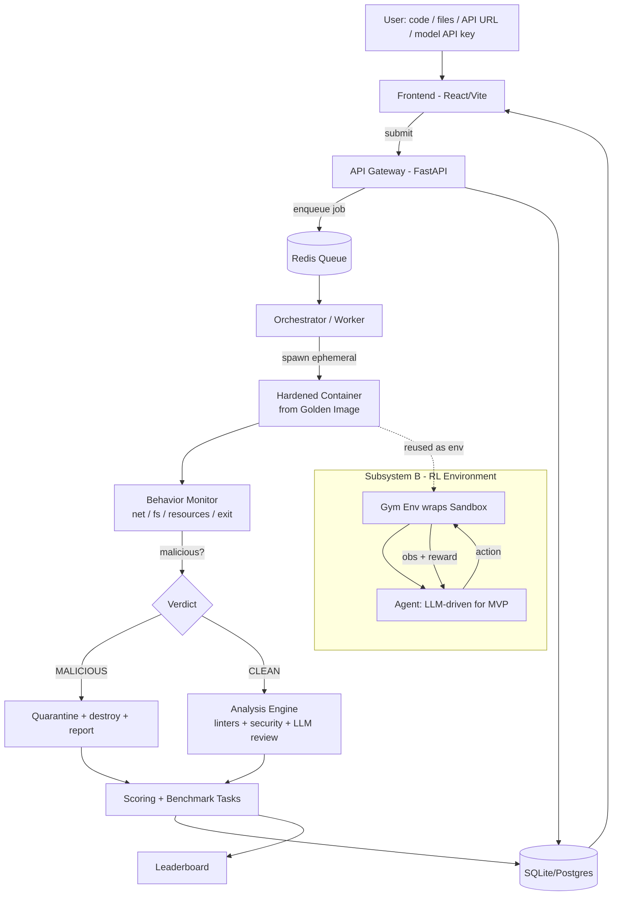

# SandBench — Build Guide
### RL Benchmarking Platform with Isolated Code Sandbox
*Working codename: SandBench (rename freely). Target: a demo-able system in ~30 focused hours.*

---

## 0. What we are building (scope lock)

A web platform where a user submits **code / files / an API endpoint / their own AI model (via API key)**. The platform runs the submission inside a **fresh, hardened, throwaway container**, watches its behavior, then branches:

- **Malicious or compromised** → kill + destroy the container, quarantine the run, report exactly what triggered the flag.
- **Clean but messy / broken** → run static analysis + an LLM review, return concrete suggestions and a proposed patch.

Every run is **scored** against a benchmark task and lands on a **leaderboard**.

There are two subsystems sharing one sandbox:

| Subsystem | What it is | Sprint priority |
|---|---|---|
| **A — Benchmark Platform** | Users submit & get scored + analyzed in isolation | **Headline (must ship)** |
| **B — RL Environment** | Same sandbox exposed as a Gym-style `obs → action → reward` env; a house agent runs/repairs tasks | **Win-multiplier (demo the loop)** |

**Honest note:** in 30 hours we build the RL *environment* and demonstrate a working rollout/reward loop. We do **not** finish training a strong agent — that's a post-sprint effort. Treat "training" here as "the loop runs, reward is logged, an agent steps through it."

**Key design reframe — "clone if affected":** you never repair a dirty container. Every run gets a **fresh container from a clean golden image** and is **destroyed after**. "Cloning" = spawning a new clean instance from the snapshot. This is simpler *and* safer than repairing in place.

---

## 1. Architecture



The whole platform is one pipe: **submission → job → ephemeral sandbox → monitored run → (quarantine | analyze) → score → store → display.** Build that pipe end-to-end first with a trivial task, *then* deepen each stage.

---

## 2. Tech stack

| Layer | Choice | Why |
|---|---|---|
| Frontend | React + Vite + Tailwind | Fast to scaffold; SSE/polling for live run status |
| API gateway | FastAPI + Pydantic | Async, typed, minimal boilerplate |
| Job queue | Redis + RQ | Simplest reliable queue (Celery if you prefer) |
| DB | SQLite + SQLAlchemy (MVP) → Postgres | Zero-config to start |
| Sandbox | Docker via `docker` SDK (docker-py) | Available everywhere; hardening flags below |
| Static analysis | `ruff`, `bandit`, `semgrep`, `yara-python`, `pip-audit` | Lint + security + malware signatures |
| LLM review | Anthropic API (`claude-sonnet-4-6`) | Code review + repair patches |
| RL env | `gymnasium` interface | Standard `reset/step` contract |
| Container monitor | docker stats + fs diff + egress policy (MVP); **Falco/eBPF/gVisor** (prod) | Be honest about MVP depth |

**Isolation MVP vs. production:** MVP = Docker with the hardening checklist in §7. Production path = **gVisor or Firecracker microVMs** (what real untrusted-code platforms use). Note it; don't build it in the sprint.

---

## 3. Repo structure

```
sandbench/
├── frontend/                # React/Vite UI
│   └── src/{pages,components,api}
├── backend/
│   ├── api/                 # FastAPI app
│   │   ├── main.py
│   │   ├── routes/          # /submit, /runs/{id}, /leaderboard
│   │   └── schemas.py       # Pydantic models
│   ├── orchestrator/
│   │   ├── worker.py        # RQ worker: pulls job → runs pipeline
│   │   └── pipeline.py      # run → monitor → verdict → analyze → score
│   ├── sandbox/
│   │   ├── runner.py        # spawn ephemeral container, run, teardown
│   │   ├── images/          # golden Dockerfiles (python, node)
│   │   └── monitor.py       # net/fs/resource/exit inspection
│   ├── analysis/
│   │   ├── static.py        # ruff/bandit/semgrep/yara/pip-audit
│   │   └── review.py        # LLM review + patch suggestion
│   ├── scoring/
│   │   ├── tasks/           # benchmark task suite
│   │   ├── score.py         # reward/score functions
│   │   └── leaderboard.py
│   ├── rl_env/
│   │   ├── env.py           # Gymnasium env wrapping the sandbox
│   │   └── train_demo.py    # rollout + reward logging loop
│   ├── db/                  # SQLAlchemy models + session
│   └── shared/              # enums, verdict types, constants
├── docker-compose.yml       # redis + api + worker + db
├── requirements.txt
└── README.md
```

---

## 4. Data model

```python
# Submission
id, type[code|files|api|model], language, payload_ref, created_at, user

# Run
id, submission_id, status[queued|running|done|quarantined|error],
container_id, started_at, finished_at,
verdict[clean|malicious|broken], score, logs_ref

# SecurityFlag
id, run_id, source[monitor|static], rule, severity, detail

# Suggestion
id, run_id, category[layout|imports|security|tests|style], message, patch_diff

# LeaderboardEntry
id, submission_id, task_id, score, rank, created_at
```

---

## 5. Build spec, component by component

**A1 — API Gateway.** Endpoints: `POST /submit` (accepts code/files/api/model + chosen task → creates Submission + Run, enqueues job, returns run id), `GET /runs/{id}` (status + result, SSE stream for live logs), `GET /leaderboard`. Validate + size-limit all uploads.

**A2 — Orchestrator / worker.** RQ worker pulls a job and runs `pipeline.run(run_id)`: build context → call sandbox runner → collect monitor output → compute verdict → if clean call analysis → score → persist. One job = one ephemeral container, always torn down in a `finally`.

**A3 — Sandbox runner.** Per run: create a container from the language golden image with the §7 hardening flags, copy in the payload, execute the task entrypoint with a hard timeout, capture stdout/stderr/exit code, snapshot the filesystem diff, then **always destroy** the container. Never reuse.

**A4 — Monitor + verdict.** Combine signals into a verdict:
- *Network:* container runs with `--network none` (or egress allowlist). Any attempted outbound connection when denied = strong malicious signal.
- *Filesystem:* compare `docker diff` against expected write paths; writes outside the workdir/tmpfs = flag.
- *Resources:* CPU/mem/PID limits; OOM or fork-bomb pattern = flag.
- *Static security:* `bandit` + `semgrep` + `yara` signature scan on the source before/after.
Verdict = `malicious` if any high-severity flag fires, else `clean`. Keep the rule list in one place so it's tunable.

**A5 — Analysis engine (clean path only).** `static.py` runs `ruff` (layout/style), `bandit` (security smells), `pip-audit` (vuln deps), reports structured issues. `review.py` sends the source + failing test output to the Anthropic API asking for: top issues, a reorganized file layout if warranted, and a unified-diff patch. Return both machine issues and the LLM suggestions.

**A6 — Scoring + leaderboard.** Each benchmark task defines a scorer (e.g. fraction of unit tests passed, latency for API tasks, correctness for model tasks). Score 0–100. Quarantined runs score 0 with reason. Leaderboard ranks per task.

**A7 — Frontend.** Three screens: **Submit** (pick type + task, upload/enter, submit), **Run view** (live status + streamed logs + verdict badge + suggestions + patch), **Leaderboard**. Keep it plain and legible; polish last.

**B — RL environment.** `env.py` implements Gymnasium `reset()`/`step(action)`:
- *Observation:* current task state — files, last command output, test results, error trace.
- *Action space (discrete, MVP):* e.g. `{run_tests, read_file, edit_file(patch), restructure, submit}`.
- *Reward:* `+` for tests passing / score gain, `−` for security flags, `−` small step cost. Episode ends on submit or step budget.
- *train_demo.py:* an LLM-driven agent (call Claude) does rollouts; log reward per step. Stretch: a toy PPO on a discrete simplified version to show a learning curve.

---

## 6. Security hardening checklist (do not skip — this is the riskiest part)

Run every container with:
- `--network none` (or a deny-by-default egress allowlist)
- `--read-only` root filesystem + a small writable `tmpfs` workdir
- non-root user (`--user`), `--cap-drop ALL`, `--security-opt no-new-privileges`
- a restrictive `seccomp` profile
- `--memory`, `--cpus`, `--pids-limit`, and a wall-clock timeout that **kills** the container
- no host volume mounts of anything sensitive; copy payloads in, never bind-mount host paths
- always `container.remove(force=True)` in a `finally` block

Never run the worker as root on the host. Treat every submission as hostile.

---

## 7. The malicious-vs-messy decision (your core branch)

```
run container (hardened) ──► collect signals
  │
  ├─ any HIGH severity flag? (egress attempt / fs escape / yara hit / OOM-fork)
  │        └─ YES ─► verdict = MALICIOUS ─► quarantine + destroy + report flags ─► score 0
  │
  └─ NO  ─► verdict = CLEAN
            ├─ tests pass + lint clean  ─► high score, "looks good"
            └─ tests fail OR lint warns ─► analysis engine ─► suggestions + patch ─► partial score
```

This single diagram *is* your differentiator — make it visible in the UI.

---

## 8. 30-hour timeline with checkpoints

| Block | Hrs | Checkpoint (definition of done) |
|---|---|---|
| 1. Design lock + scaffold | 3 | Repo, docker-compose up, FastAPI hello, React hello |
| 2. Gateway + queue + DB | 5 | `POST /submit` creates a Run, worker picks it up, status updates in UI |
| 3. Sandbox runner + golden images | 6 | Arbitrary Python runs in a hardened throwaway container; teardown verified |
| 4. Monitor + verdict + quarantine | 5 | A deliberately-malicious test sample gets flagged + quarantined |
| 5. Analysis engine | 4 | Messy clean code returns lint issues + an LLM patch |
| 6. Scoring + tasks + leaderboard | 3 | A submission gets a real score and appears ranked |
| 7. RL env + demo loop | 3 | `env.reset/step` works; rollout logs reward for one task |
| 8. Test + harden + polish | 1 | Full end-to-end demo run, both paths |

**If behind, cut in this order (the cut-list):** Node support → toy PPO (keep just the rollout loop) → API/model submission types (keep code+files) → leaderboard ranking (keep raw scores). **Never cut §6 hardening.**

---

## 9. Getting started (Hour 0 commands)

```bash
mkdir sandbench && cd sandbench
git init
python -m venv .venv && source .venv/bin/activate
pip install fastapi uvicorn pydantic sqlalchemy redis rq docker \
            ruff bandit semgrep yara-python pip-audit gymnasium anthropic
npm create vite@latest frontend -- --template react
# docker-compose.yml: services = redis, api (uvicorn), worker (rq), db
docker compose up -d redis
uvicorn backend.api.main:app --reload   # in one terminal
rq worker -u redis://localhost:6379      # in another
```

First task to prove the pipe: a `POST /submit` that runs `print("hello")` in a hardened container and shows the output in the UI. Get *that* green before anything else, then add one stage at a time down the §8 table.

---

## 10. Definition of done (demo script)

1. Submit clean working code → green verdict + high score + leaderboard entry.
2. Submit messy-but-clean code → suggestions + a patch diff + partial score.
3. Submit a deliberately malicious sample → quarantined, container destroyed, flags shown.
4. Run `train_demo.py` → agent steps through the RL env, reward logged per step.

Hit those four and the build demos itself.
