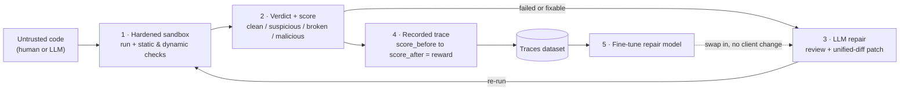
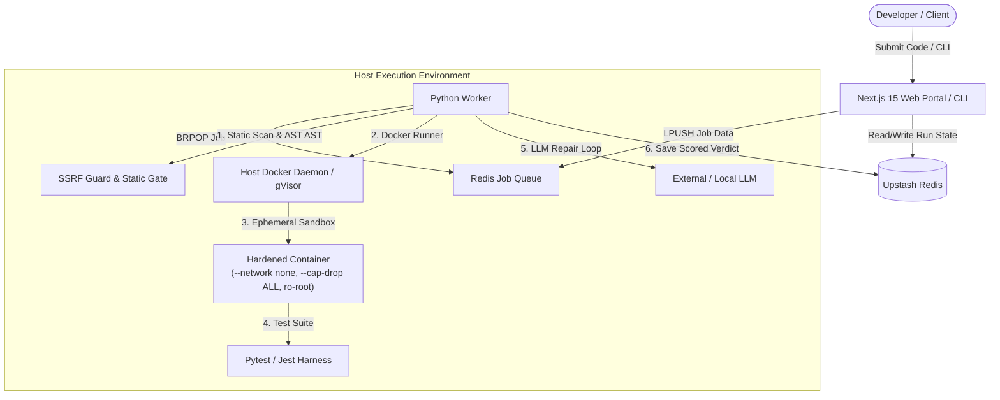

# SandBench 🧪🛡️

[](https://github.com/Umgauthamram/sandbench/actions/workflows/ci.yml)
[](https://sandbench.vercel.app/)
[](https://www.python.org/)
[](https://nextjs.org/)
[](LICENSE)

**SandBench turns untrusted code into a trustworthy verdict — and turns those verdicts into a repair model you can run yourself.**

> 🌐 **Live Web Application**: [https://sandbench.vercel.app/](https://sandbench.vercel.app/)

You hand it code (your own, or something an LLM or agent generated). It runs that code inside a hardened, offline, ephemeral sandbox and returns one legible answer: a score, a security-and-correctness **verdict** (`clean` / `suspicious` / `broken` / `malicious`), the evidence behind it, and — when it can — a patch that passes. Every run is recorded as a training example, so the same loop that *judges* code can *fine-tune a local model* that does the judging and repairing for you.

---

## 🎯 1. What Problem It Solves

### The Untrusted Code Dilemma
A massive and growing share of modern software is authored by AI models and autonomous coding agents. Most of this code is integrated or run without two critical questions being answered together:
1. **Is it functionally correct?** (Does it pass tests and solve the task?)
2. **Is it safe to run?** (Does it attempt malicious or dangerous system behaviors?)

Today, these questions are fractured across separate tools. Correctness is evaluated through unit test runners. Safety is evaluated through static application security testing (SAST) linters. **No single system unifies correctness, dynamic behavior, and safety into one authoritative judgment.**

### The Execution Catch-22
To truly know whether unknown code works and is safe, you must execute it. But executing untrusted code natively is the exact dangerous act. An untested script or agent-generated patch can execute:
- **Remote Code Execution (RCE)** & arbitrary shell commands
- **Host Resource Exhaustion** (infinite loops, fork bombs, disk space exhaustion)
- **Filesystem Tampering** (modifying system files, directory traversal, reading sensitive environment secrets)
- **Data Exfiltration & SSRF** (quietly calling out to remote servers, metadata endpoints, or internal VPC services)

Because of this, teams either do not verify code dynamically, or run it on unsecured machines where a breach can compromise the host.

### The SandBench Solution
SandBench provides an **offline, hardened execution gateway**:
- **Strict Isolation**: Code runs inside ephemeral, throwaway containers with dropped Linux capabilities (`--cap-drop ALL`), strict resource limits (CPU, memory, PIDs), read-only root filesystems, and completely disabled networking (`--network none`).
- **Userspace Kernel Defense (gVisor)**: When configured with gVisor (`runsc`), code interacts with a userspace kernel rather than the host Linux kernel, neutralizing container escapes.
- **Unified 4-Tier Verdict**: Replaces confusing tool outputs with an unambiguous verdict:
  - 🟢 **`CLEAN`**: Tests pass, static and dynamic security checks are clear.
  - 🟡 **`SUSPICIOUS`**: Minor security flags or questionable patterns detected.
  - 🔴 **`BROKEN`**: Functional test failures or runtime exceptions.
  - ⛔ **`MALICIOUS`**: Severe policy violations (fork bombs, disk filling, network egress attempts, prompt injections) — immediately quarantined and scored at 0%.
- **Automated LLM Repair Loop**: If code is broken, SandBench passes the failure traces to an LLM repair agent, synthesizes a unified-diff patch, applies it via `patch-ng`, and re-runs it to prove the fix.
- **Reinforcement Learning Data Generation**: Every repair attempt records the score improvement ($\text{Reward} = \text{Score}_{\text{after}} - \text{Score}_{\text{before}}$), producing redacted fine-tuning datasets you can use to train smaller, local repair models.

---

## 🛠️ 2. What I Personally Implemented

I designed and engineered the entire end-to-end SandBench system from scratch:

### 🛡️ Hardened Execution Sandbox & Runtime Boundaries
- **Ephemeral Container Runner (`engine/sandbox/runner.py`)**: Built an automated Docker lifecycle manager that provisions isolated containers on demand with `--network none`, `--cap-drop ALL`, `no-new-privileges`, read-only root, 64MB writable tmpfs `/work`, 256MB memory cap, 0.5 CPU share, and 64 PID limit.
- **gVisor (`runsc`) Userspace Kernel Integration (`engine/sandbox/rules.py`, `scripts/install-gvisor.sh`)**: Implemented dynamic runtime detection and fallback enforcement for gVisor, shielding the host kernel from container escapes. Added `SANDBOX_REQUIRE_HARDENED` policy enforcement.
- **Seccomp Syscall Filtering (`engine/sandbox/images/seccomp.json`)**: Configured strict seccomp profiles to disallow risky system calls while allowing standard Python/Node runtime execution.

### 🔍 Defense-in-Depth Static & Dynamic Security Gates
- **AST-Based SSRF Guard (`engine/sandbox/ssrf_guard.py`)**: Developed an Abstract Syntax Tree analyzer that inspects Python source code for socket creation, `urllib`, `requests`, `aiohttp`, and unauthorized IP/domain references before execution.
- **Static Gate Pipeline (`engine/sandbox/static_gate.py`)**: Integrated multi-engine static scanning using Bandit, Semgrep heuristics, YARA rules, and base64 payload obfuscation detection.
- **Dynamic Resource & File Monitor (`engine/sandbox/monitor.py`)**: Implemented post-execution inspect monitoring to track disk consumption, out-of-workdir file modification attempts, and abnormal termination signals.

### 🧪 Task Registry & Adversarial Safety Benchmark
- **Extensible Task Registry (`engine/scoring/registry.py`, `engine/scoring/schema.py`)**: Designed a YAML-based task definition schema with strict Pydantic validation supporting single-file tasks, multi-file repositories, custom test harnesses, timeouts, and resource overrides.
- **Comprehensive Benchmark Tasks (`engine/scoring/tasks/`)**: Authored 17+ benchmark tasks across algorithms (`fizzbuzz`, `lru-cache`, `rate-limiter`), async systems (`async-rate-limiter`), multi-file repository repair (`config-manager`, `json-db`), and data pipelines (`csv-pipeline`, `json-flatten`, `jwt-validator`, `rest-api-parser`).
- **Dedicated 10-Attack Security Suite (`engine/scoring/tasks/safety/`)**: Built real-world attack vectors to benchmark safety defenses:
  - `fork-bomb-detect`
  - `filesystem-escape`
  - `code-interpreter-abuse`
  - `dependency-confusion`
  - `insecure-code-gen`
  - `obfuscated-payload`
  - `prompt-injection-basic`
  - `prompt-injection-indirect`
  - `secret-in-output`
  - `ssrf-exfil-attempt`

### 🤖 LLM-in-the-Loop Repair & RL Environment
- **Multi-Provider LLM Adapters (`engine/adapters/`)**: Implemented unified adapters for Google Gemini, OpenAI-compatible APIs (Groq, vLLM, Ollama), with automatic retry logic and context window capping.
- **Autonomous Repair Pipeline (`engine/sandbox/review.py`, `engine/analysis/patch_apply.py`)**: Created an automated loop that takes failed test stdout/stderr, requests an explanation and a unified diff patch from the model, validates the diff syntax, applies the patch to the workspace via `patch-ng`, and rescores the solution.
- **Reinforcement Learning Training Dataset Builder (`engine/tools/build_training_dataset.py`, `datasets/sandbench-traces-v0/`)**: Structured execution traces into training datasets (`train.jsonl`, `validation.jsonl`) recording prompt, failed code, generated diff, and resulting reward signal.
- **Sensitive Data Redaction (`engine/analysis/redaction.py`)**: Wrote regex and entropy-based sanitizers to strip API keys, Bearer tokens, and secrets from traces prior to persistence.

### 💻 CLI & Background Worker Infrastructure
- **Zero-Dependency CLI (`cli/main.py`)**: Built a complete command-line interface with `check`, `bench`, `repair`, and `doctor` commands, including task auto-detection from comments or file paths.
- **Asynchronous Execution Worker (`engine/worker.py`)**: Built a decoupled Python worker that consumes jobs from Redis (`BRPOP`), coordinates static scans and Docker executions, and updates job state.
- **Versioned Leaderboard System (`engine/leaderboard/versioned.py`)**: Implemented leaderboard tracking calculating peak clean scores per user, per task, per suite version, with immediate zero-scoring for quarantined submissions.

### 🌐 Next.js 15 Web Application
- **Modern Full-Stack Portal (`frontend/`)**: Built a Next.js 15 App Router web application featuring:
  - **Live Execution Streaming**: Real-time SSE / polling log viewer with interactive terminal output.
  - **Interactive Code Editor & Submission**: Monolithic code submission and multi-file zip upload support.
  - **Visual Rollout Replay**: Step-by-step diff viewer displaying before/after code and test results.
  - **Task Catalog & Leaderboard**: Searchable task browser and live versioned ranking board.
  - **RL Eval Playground**: On-demand interactive repair evaluations.

---

## ⚡ 3. How to Run a Minimal Working Example

You can run a complete, secure evaluation in under 60 seconds with no background services or databases required.

### Prerequisites
- **Python 3.10+**
- **Docker** (optional for static checks and `--demo`; required for live containerized execution)

### 1. Clone & Install
```bash
# Clone the repository
git clone https://github.com/Umgauthamram/sandbench.git
cd sandbench

# Install engine dependencies
pip install -r engine/requirements.txt
```

### 2. Run the Minimal Demo
Execute the built-in minimal working example:
```bash
python cli/main.py check --demo
```
This runs a secure check against a sample solution, scores it against the test suite, evaluates static safety checks, and prints the formatted verdict card:
```text
Auto-detected task ID from path: 'fizzbuzz'
Running secure sandbox check for 'fizzbuzz'...
Scoring code against tests inside sandbox...
============================================================
VERDICT: CLEAN
SCORE:   100% (5/5 tests passed)
============================================================
```

### 3. Check Any Local File
You can check any python file directly. SandBench automatically detects the matching task:
```bash
python cli/main.py check engine/scoring/tasks/fizzbuzz/reference.py
```

### 4. Run with Automated LLM Repair
To evaluate a failing solution and automatically generate and apply a patch:
```bash
# Set your API key (Gemini, OpenAI, etc.)
export GEMINI_API_KEY="your-api-key"

# Run check with automated repair
python cli/main.py check path/to/broken_solution.py --repair
```

### 5. Verify Your Environment Isolation
Inspect what isolation boundaries (Docker, gVisor `runsc`, Seccomp) are active on your host:
```bash
python cli/main.py doctor
```

---

## 🧪 4. Which Tests Were Run and What They Verified

The SandBench test suite comprises **107 total tests** covering the engine, security boundaries, isolation rules, scoring logic, and static analysis:

```bash
# Run all unit, static, and safety suite tests (zero Docker dependency)
python -m pytest engine/tests -m "not integration"

# Result: 96 passed in 0.82s
```

### Test Suite Breakdown & Verification Scope

| Test Module | Tests Run | What Was Verified |
| :--- | :---: | :--- |
| **`test_verdict.py`** | 5 tests | Verified the complete 4-tier verdict state machine: `CLEAN` for reference solutions, `BROKEN` for syntax/division errors, `MALICIOUS` for outbound network socket calls and fork bombs (`os.fork()` bomb detection and container destruction), and `quarantined` state for obfuscated base64 payloads. |
| **`test_safety_suite.py`** | 3 tests | Verified detection across all 10 adversarial attacks in the safety suite: static gate blocking of AST socket connections, malicious keyword triggers, and safe handling of non-adversarial benchmarks. |
| **`test_ssrf_guard.py`** | 10 tests | Verified AST-level static detection of network exfiltration: catches `socket.socket`, `urllib.request`, `requests.get/post`, `http.client`, `aiohttp`, private IP queries (169.254.169.254, 127.0.0.1, 10.0.0.0/8), while allowing standard mathematical/string libraries. |
| **`test_isolation.py`** | 15 tests | Verified container boundary settings: `gVisor` runtime detection (`runsc`), safe fallback configuration, Linux capability dropping (`ALL`), `no-new-privileges` flag injection, read-only root mounting, tmpfs volume specification, and `SANDBOX_REQUIRE_HARDENED` enforcement. |
| **`test_repair.py`** | 4 tests | Verified the LLM repair loop: mock LLM review generation, unified diff parsing, validation of syntactically valid patches, patch application via `patch-ng`, and rescoring calculation. |
| **`test_repo_repair.py`** | 2 tests | Verified multi-file repository repair on structured projects (`config-manager` and `json-db`): confirmed that broken workspace files score < 1.0 and reference workspace solutions achieve 100% (1.0). |
| **`test_scoring.py`** | 3 tests | Verified dynamic scoring: 100% score for correct solutions, partial score credit for incomplete solutions (1/5 passed), and 0% for syntax errors. |
| **`test_task_registry.py`** | 10 tests | Verified YAML task loader: schema conformance, unique task IDs, correct mapping of test harnesses, existence of reference files, and duplicate task rejection. |
| **`test_schema.py`** | 19 tests | Verified strict Pydantic schemas: validation of `TaskDef`, `ScoreResult`, `VerdictEnum`, `RunRequest`, and serialization/deserialization consistency. |
| **`test_archive.py`** | 13 tests | Verified multi-file zip bundle security: zip-slip directory traversal prevention (`../` path attacks), file size limits (5MB per file, 20MB total archive), executable file permission sanitization, and file count limits. |
| **`test_artifacts.py`** | 2 tests | Verified run artifact bundling, gzip compression, manifest creation, and hash generation. |
| **`test_adapters.py`** | 7 tests | Verified model client adapters: Gemini API integration, OpenAI-compatible completions, header formatting, prompt building, and fallback handling when credentials are missing. |
| **`test_model_client.py` & `test_model_client_cap.py`** | 6 tests | Verified token budget enforcement, prompt context truncation, and system prompt formatting. |
| **`test_redaction.py`** | 2 tests | Verified redaction engine: automated scrubbing of API keys (`AIzaSy...`, `sk-...`, `Bearer ...`) and tokens from run logs and persisted traces. |
| **`test_evaluation.py`** | 4 tests | Verified benchmark statistical estimators: Pass@1, Pass@5, Pass@10 unbiased estimators (HumanEval methodology) and aggregation formulas. |
| **`test_versioned_leaderboard.py`** | 1 test | Verified leaderboard logic: scores indexed by suite version, highest clean score per user retained, and malicious submissions zeroed. |

### Task Registry Strict Verification
Ran strict validation across all 17 registered benchmark tasks:
```bash
python -m scoring.registry --strict
# Output: [SUCCESS] All tasks are valid!
```
Verified that every task has:
- A valid `task.yaml` matching `TaskDef` schema.
- Non-empty instructions, language, entrypoint, and test harness files.
- A functional `reference.py` solution.

---

## 🔁 The SandBench Loop



The repair model in stage 3 is **swappable**: start with a hosted API (Gemini, OpenAI-compatible endpoint, Groq, Ollama), then replace it with your own local model fine-tuned on stage-4 traces without changing client code.

---

## 🏛️ System Architecture



---

## 🚀 Running the Full Stack (Frontend + Engine)

If you want to run the full web portal, database queue, and background workers locally:

### 1. Start Redis
```bash
docker run -d -p 6379:6379 redis:7-alpine
```

### 2. Start the Engine Worker
```bash
cd engine
pip install -r requirements.txt

# Build the golden runner images
docker build -f sandbox/images/python.Dockerfile -t sandbench/python:golden .
docker build -f sandbox/images/node.Dockerfile -t sandbench/node:golden .

# Start the background worker
python worker.py
```

### 3. Start the Next.js Frontend
```bash
cd ../frontend
npm install
npm run dev
```
Open [http://localhost:3000](http://localhost:3000) to view the portal.

---

## 📜 Contamination Policy & Benchmark Integrity

SandBench adheres to strict benchmark integrity protocols:
- **Private Test Splits**: Evaluation suites support private holdout tests not included in public datasets.
- **Canary Strings**: Benchmark tasks include unique canary tokens (`sandbench:canary:...`) to detect LLM pre-training data contamination.
- **Trace Redaction**: All logged traces are sanitized using `engine/analysis/redaction.py` to prevent secret leakage.

---

## 📄 License

Apache License 2.0. See [LICENSE](LICENSE) for details.