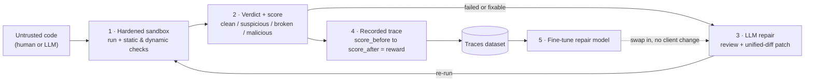
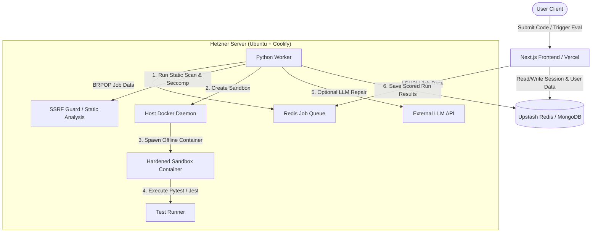

# SandBench 🧪🛡️

WEBSITE link : https://sandbench.vercel.app/

**SandBench turns untrusted code into a trustworthy verdict — and turns those verdicts into a repair model you can run yourself.**

You hand it code (your own, or something an LLM or agent generated). It runs that code inside a hardened, offline, ephemeral sandbox and returns one legible answer: a score, a security-and-correctness **verdict** (`clean` / `suspicious` / `broken` / `malicious`), the reasons behind it, and — when it can — a patch that passes. Every run is also recorded as a training example, so the same loop that *judges* code can *fine-tune a local model* that does the judging and repairing for you.

It is one engine. You reach it through one of two doors, depending on what you need.

---

## ⚡ Quickstart (60 Seconds)

Get a code trust verdict synchronously on a fresh machine in three lines of code.

### Prerequisites
* **Docker** installed and running on your machine.
* **Python** (v3.10+) installed.

### Commands
```bash
# 1. Clone the repository and navigate inside
git clone https://github.com/Umgauthamram/sandbench.git && cd sandbench

# 2. Install the lightweight engine requirements
pip install -r engine/requirements.txt

# 3. Run the built-in demo task check (securely evaluates a buggy solution and prints the verdict card)
python cli/main.py check --demo
```

---

## 🚪 Two Doors, One Engine

* **🔍 Check — "Is this code safe and correct?"**
  For a developer or an agent pipeline. Submit one piece of code; get back a verdict, the reasons, and a repaired version. This is the everyday path (CLI or web). You know what you want — *is my code good?* — and you get exactly that.

* **🏗️ Bench / Train — "Make a model better at this."**
  For a team improving a model. Point a model or agent at a whole task suite. The same engine runs it many times and produces a versioned leaderboard, replayable run artifacts, and a redacted traces dataset you can fine-tune on.

Run the engine **once** = Check. Run it **a thousand times** = Bench. What you do with the thousand runs = **Train**. The benchmark and the RL repair environment are not two products — they are this single engine at two scales.

---

## 🔁 The Loop



The repair model in stage 3 is **swappable**: start with a hosted API (Gemini, any OpenAI-compatible endpoint, Groq, Hugging Face), then replace it with your own fine-tuned local model trained on the stage-4 traces — without touching client code. A leaderboard row is disposable; a model you own is not.

---

## Why SandBench?

Evaluating code generated by Large Language Models or running unknown user submissions carries severe security risks. Executing untrusted code natively can expose the host system to:
* Remote Code Execution (RCE)
* Host resource exhaustion (infinite loops, fork bombs)
* Host filesystem tampering or private data leakage
* Server-Side Request Forgery (SSRF) and malicious outbound network traffic

**SandBench solves this by being a secure execution gateway that ends in something useful.** It accepts code, routes it through static and dynamic security checks, runs tests in a hardened sandbox, returns a verdict a developer can trust, and optionally drives an LLM-in-the-loop repair agent to fix broken solutions and measure the improvement (reward) in real time.

It is also **self-hostable and offline by design** — the entire check-and-repair loop runs on a single host with sandbox networking disabled. Code never has to leave your network, which is the difference for proprietary, regulated, or air-gapped work that cannot use a cloud sandbox.

---

## Key Features

* 🧭 **Verdict, Not Just Pass/Fail**: Every run returns a single trust judgment — `clean` / `suspicious` / `broken` / `malicious` — backed by evidence: monitorability traces of blocked network calls, out-of-`/work` filesystem writes, and resource limits hit. Security and correctness in one answer.
* 🚀 **Hardened Ephemeral Sandboxes**: Every run executes inside a fresh, temporary Docker container with:
  * Strict resource limits (`256m` memory, `0.5` CPU share, `64` PID limit).
  * Outbound networking completely disabled (`--network none`).
  * Root filesystem mounted read-only, except a writable `/work` `tmpfs`.
  * Linux capabilities dropped (`--cap-drop ALL`) and `no-new-privileges` enforced.
  * Static gates: Bandit, Semgrep, YARA, and obfuscation heuristics.
* 🧱 **Pluggable Isolation Boundary (gVisor)**: The sandbox runtime is configurable. With gVisor (`runsc`) installed, submissions execute behind a **userspace kernel** — the Sentry implements the syscall interface in userspace and forwards only a narrow filtered set to the host, so a container escape has to break the Sentry before it reaches the host kernel. No hardware virtualisation required, so it works on an ordinary VPS or laptop. Set `SANDBOX_REQUIRE_HARDENED=1` and a run is *refused* rather than executed on the shared-kernel runtime. Every result records which boundary produced it. See **[docs/isolation.md](docs/isolation.md)**.

  ```bash
  sudo bash scripts/install-gvisor.sh   # install + register runsc with Docker
  python cli/main.py doctor             # report the boundary this host will actually use
  ```
* 🤖 **RL Repair Loop That Produces Training Data**: Connect any model as a repair agent. SandBench drives a rollout, scores the improvement, and records each attempt as a fine-tuning example:
  $$\text{Reward} = \text{Score}_{\text{after}} - \text{Score}_{\text{before}}$$
* 🔁 **Bring-Your-Own / Own-Your-Model**: Start on a hosted endpoint; fine-tune on your own traces; swap in a local model with no client changes.
* 🏆 **Versioned Leaderboard**: Peak score per user, per task, per suite version. Submissions flagged malicious by static or dynamic analysis are quarantined and score 0%.
* 🔒 **API Key Safety**: User-supplied keys are held only in host-side memory to reach your provider. They are never written to the database, persistent logs, or output traces.
* 📡 **Language-Agnostic Queue**: A light Redis-list queue lets the Next.js frontend (TypeScript) and the Python engine communicate asynchronously.

---

## 🏗️ Production / Bench-Train Deployment

Use this guide for setting up the multi-user web app frontend, Redis queue, and the background execution workers.

### Local Infrastructure Setup

#### 1. Setup the Engine (Backend Worker)
1. Navigate to the engine folder:
   ```bash
   cd engine
   ```
2. Create and activate a virtual environment:
   ```bash
   python -m venv .venv
   # Windows:
   .venv\Scripts\Activate.ps1
   # Linux/macOS:
   source .venv/bin/activate
   ```
3. Install the dependencies:
   ```bash
   pip install -r requirements.txt
   ```
4. Build the golden container runner images locally:
   ```bash
   # Python Sandbox Image:
   docker build -f sandbox/images/python.Dockerfile -t sandbench/python:golden .
   # Node Sandbox Image:
   docker build -f sandbox/images/node.Dockerfile -t sandbench/node:golden .
   ```
5. Create a `.env` file in the `engine` directory:
   ```env
   UPSTASH_REDIS_URL=redis://localhost:6379
   LLM_PROVIDER=gemini
   GEMINI_API_KEY=your_key_here
   ```
6. Start the worker:
   ```bash
   python worker.py
   ```

#### 2. Setup the Frontend Portal
1. Navigate to the frontend folder:
   ```bash
   cd ../frontend
   ```
2. Install the node modules:
   ```bash
   npm install
   ```
3. Create a `.env` file in the `frontend` directory:
   ```env
   UPSTASH_REDIS_REST_URL=http://localhost:6379
   UPSTASH_REDIS_REST_TOKEN=dummy_token
   AUTH_SECRET=your_32_byte_secret_here
   ENCRYPTION_KEY=your_32_byte_hex_key_here
   ```
4. Run the Next.js development server:
   ```bash
   npm run dev
   ```
5. Open [http://localhost:3000](http://localhost:3000) in your browser.

---

### Cloud Deployment

#### Frontend Portal (Vercel)
Import the `frontend` subdirectory of your repository into Vercel. 
* Under **Project Settings > General**, set the **Root Directory** to `frontend` and make sure the **Framework Preset** is set to **Next.js**.
* Supply the required environment variables (`UPSTASH_REDIS_REST_URL`, `UPSTASH_REDIS_REST_TOKEN`, `AUTH_SECRET`, and `ENCRYPTION_KEY`).

#### Execution Worker (Ubuntu Server + Coolify)
1. Build the worker image and push it to your registry (e.g., Docker Hub).
2. Create a new **Docker Image** resource in Coolify.
3. Under the resource settings, go to **Volumes** and mount the host Docker socket:
   ```text
   /var/run/docker.sock:/var/run/docker.sock
   ```
4. Add the required environment variables (`UPSTASH_REDIS_URL`, `GEMINI_API_KEY`, etc.).
5. SSH into the host server and build the golden images so they are available to the host daemon:
   ```bash
   # Build Python golden
   docker build -t sandbench/python:golden - < engine/sandbox/images/python.Dockerfile
   # Build Node golden
   docker build -t sandbench/node:golden - < engine/sandbox/images/node.Dockerfile
   ```
6. Deploy the worker in Coolify.

---

## 📂 System Architecture & Folder Directory

### System Architecture Diagram


### End-to-End Sequence Flow

```mermaid
sequenceDiagram
    autonumber
    actor User as User Client
    participant FE as Next.js API (Vercel)
    participant Redis as Redis DB (Upstash)
    participant Worker as Python Worker (Hetzner)
    participant Docker as Docker Host
    participant LLM as External LLM API
    
    User->>FE: POST /api/submit or /api/rl-eval
    Note over FE: Authenticates user & validates input schemas
    FE->>Redis: SET run:id (status: queued)
    FE->>Redis: LPUSH sandbench:jobs {job}
    FE-->>User: Return run_id (201 Created)
    
    Note over Worker: Listening on Queue
    Redis->>Worker: BRPOP job data
    Worker->>Worker: Run static scans (Bandit/Semgrep) & SSRF safety check
    
    rect rgb(24, 24, 27)
        Note over Worker, Docker: Dynamic Sandbox Execution
        Worker->>Docker: Create container (sandbench/*:golden)
        Docker->>Docker: Mount /work tmpfs, apply CPU/memory/PID limits & drop network
        Worker->>Docker: Start container and run Pytest / Jest
        Docker-->>Worker: Return exit code, stdout, and stderr
        Worker->>Docker: Destroy container
    end
    
    alt Optional LLM Repair Loop (If failed tests)
        Worker->>LLM: Send code & error logs to request patch
        LLM-->>Worker: Return review text & unified diff patch
        Worker->>Worker: Apply patch via patch-ng
        Worker->>Docker: Create new container and re-run tests
        Docker-->>Worker: Return updated score (calculate reward)
        Worker->>Docker: Destroy container
    end
    
    Worker->>Redis: SET sandbench:run:id {results}
    Worker->>Redis: Update leaderboard (if clean high score)
    
    loop Real-time Polling / Streaming
        User->>FE: GET /api/runs/[id]
        FE->>Redis: GET sandbench:run:id
        Redis-->>FE: Return run state & logs
        FE-->>User: Display status, score, and repair logs
    end
```
