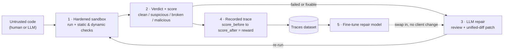

# SandBench Positioning Rewrite

Two paste-ready blocks. **Block A** replaces the top of `readme.md` (from the title down through `## Key Features`). Everything from `## System Architecture` onward stays exactly as it is. **Block B** replaces the `## Target Combined Feature Set` section in `docs/benchmark-landscape.md`.

---

## BLOCK A — new `readme.md` opening

> Replace from the first line through the end of `## Key Features`. Keep `## System Architecture`, `## Detailed Execution Flow`, `## Folder Structure`, and the setup guide unchanged — their mermaid diagrams still apply.

```markdown
# SandBench 🧪🛡️
WEBSITE link : https://sandbench.vercel.app/

**SandBench turns untrusted code into a trustworthy verdict — and turns those verdicts into a repair model you can run yourself.**

You hand it code (your own, or something an LLM or agent generated). It runs that code inside a hardened, offline, ephemeral sandbox and returns one legible answer: a score, a security-and-correctness **verdict** (`clean` / `suspicious` / `broken` / `malicious`), the reasons behind it, and — when it can — a patch that passes. Every run is also recorded as a training example, so the same loop that *judges* code can *fine-tune a local model* that does the judging and repairing for you.

It is one engine. You reach it through one of two doors, depending on what you need.

---

## 🚪 Two Doors, One Engine

* **🔍 Check — "Is this code safe and correct?"**
  For a developer or an agent pipeline. Submit one piece of code; get back a verdict, the reasons, and a repaired version. This is the everyday path (CLI or web). You know what you want — *is my code good?* — and you get exactly that.

* **🏗️ Bench / Train — "Make a model better at this."**
  For a team improving a model. Point a model or agent at a whole task suite. The same engine runs it many times and produces a versioned leaderboard, replayable run artifacts, and a redacted traces dataset you can fine-tune on.

Run the engine **once** = Check. Run it **a thousand times** = Bench. What you do with the thousand runs = **Train**. The benchmark and the RL repair environment are not two products — they are this single engine at two scales.

---

## 🔁 The Loop



The repair model in stage 3 is **swappable**: start with a hosted API (Gemini, any OpenAI-compatible endpoint, Groq, Hugging Face), then replace it with your own fine-tuned local model trained on the stage-4 traces — without touching client code. A leaderboard row is disposable; a model you own is not.

---

## Why SandBench?

Evaluating code generated by Large Language Models or running unknown user submissions carries severe security risks. Executing untrusted code natively can expose the host system to:
* Remote Code Execution (RCE)
* Host resource exhaustion (infinite loops, fork bombs)
* Host filesystem tampering or private data leakage
* Server-Side Request Forgery (SSRF) and malicious outbound network traffic

**SandBench solves this by being a secure execution gateway that ends in something useful.** It accepts code, routes it through static and dynamic security checks, runs tests in a hardened sandbox, returns a verdict a developer can trust, and optionally drives an LLM-in-the-loop repair agent to fix broken solutions and measure the improvement (reward) in real time.

It is also **self-hostable and offline by design** — the entire check-and-repair loop runs on a single host with sandbox networking disabled. Code never has to leave your network, which is the difference for proprietary, regulated, or air-gapped work that cannot use a cloud sandbox.

---

## Key Features

* 🧭 **Verdict, Not Just Pass/Fail**: Every run returns a single trust judgment — `clean` / `suspicious` / `broken` / `malicious` — backed by evidence: monitorability traces of blocked network calls, out-of-`/work` filesystem writes, and resource limits hit. Security and correctness in one answer.
* 🚀 **Hardened Ephemeral Sandboxes**: Every run executes inside a fresh, temporary Docker container with:
  * Strict resource limits (`256m` memory, `0.5` CPU share, `64` PID limit).
  * Outbound networking completely disabled (`--network none`).
  * Root filesystem mounted read-only, except a writable `/work` `tmpfs`.
  * Linux capabilities dropped (`--cap-drop ALL`) and `no-new-privileges` enforced.
  * Static gates: Bandit, Semgrep, YARA, and obfuscation heuristics.
* 🤖 **RL Repair Loop That Produces Training Data**: Connect any model as a repair agent. SandBench drives a rollout, scores the improvement, and records each attempt as a fine-tuning example:
  $$\text{Reward} = \text{Score}_{\text{after}} - \text{Score}_{\text{before}}$$
* 🔁 **Bring-Your-Own / Own-Your-Model**: Start on a hosted endpoint; fine-tune on your own traces; swap in a local model with no client changes.
* 🏆 **Versioned Leaderboard**: Peak score per user, per task, per suite version. Submissions flagged malicious by static or dynamic analysis are quarantined and score 0%.
* 🔒 **API Key Safety**: User-supplied keys are held only in host-side memory to reach your provider. They are never written to the database, persistent logs, or output traces.
* 📡 **Language-Agnostic Queue**: A light Redis-list queue lets the Next.js frontend (TypeScript) and the Python engine communicate asynchronously.
```

---

## BLOCK B — replacement for `## Target Combined Feature Set`

> In `docs/benchmark-landscape.md`, keep the `## Projects Reviewed` table and `## SandBench Today` as they are. Replace the `## Target Combined Feature Set` section with the following. (The "Source Links" section can stay.)

```markdown
## What SandBench Is (and Isn't)

SandBench is **not** trying to be another benchmark platform. The projects in the table above — SWE-bench, Inspect AI, AgentBench, BigCodeBench — already own the "rank models across a large task suite" category. Competing on task count is a race we lose by definition, and framing SandBench as a smaller version of them is what makes the product read as derivative.

SandBench is a different shape:

> **A closed loop that turns untrusted code into a trust verdict, and turns verdicts into a self-hosted repair model.**

The nearest real comparable is **HUD / Prime Intellect** (the eval-to-training-data loop), not SWE-bench. We do not beat them on cloud scale and should not try. We differentiate on three axes none of them combine:

1. **Verdict-first output.** Security *and* correctness expressed as one trust judgment with evidence (monitorability traces), not a bare pass-fraction. Other tools hand you an isolated box or a score and leave the "should I trust this?" question to you.
2. **Self-hostable and offline.** The whole loop runs on one host with sandbox networking disabled. Every major comparable is cloud-first. This is the wedge for proprietary, regulated, or air-gapped code that structurally cannot use a hosted sandbox.
3. **The loop yields an owned asset.** Traces become a fine-tuned local repair model, not a disposable leaderboard entry.

## How the Engine Is Built

The four surfaces below are the **internals** of that loop — how the engine is built, not what the product is. They are sequenced so each one feeds the next, rather than shipped as four parallel features.

1. **Task suites** — versioned task packs with metadata, hidden tests, reference solutions, tags, human-baseline estimates, and benchmark-readiness flags. *(Feeds: what the sandbox runs.)*
2. **Execution harness** — strict sandbox runner, deterministic scoring, retries, pass@k, artifacts, audit logs. *(Produces: the verdict + score.)*
3. **Model/agent adapters** — OpenAI-compatible endpoints plus named providers, external CLI agents, local models, cost/token tracking, safe secrets handling. *(Powers: the repair stage, and the swap to a local model.)*
4. **Safety evaluation** — static/dynamic gates, prompt-injection tasks, code-interpreter abuse checks, exfiltration/SSRF tests, insecure-code tests, monitorability traces. *(Sharpens: the verdict, especially `suspicious` and `malicious`.)*

A task is not benchmark-ready until it has metadata, hidden tests, a reference solution, and deterministic scoring — because every run also becomes training data, and bad signal poisons the model the loop is meant to produce.
```