```mermaid
sequenceDiagram
    autonumber
    actor User as User Client
    participant FE as Next.js API (Vercel)
    participant Redis as Redis DB (Upstash)
    participant Worker as Python Worker (Hetzner)
    participant Docker as Docker Host
    participant LLM as External LLM API
    
    User->>FE: POST /api/submit or /api/rl-eval
    Note over FE: Authenticates user & validates input schemas
    FE->>Redis: SET run:id (status: queued)
    FE->>Redis: LPUSH sandbench:jobs {job}
    FE-->>User: Return run_id (201 Created)
    
    Note over Worker: Listening on Queue
    Redis->>Worker: BRPOP job data
    Worker->>Worker: Run static scans (Bandit/Semgrep) & SSRF safety check
    
    rect rgb(24, 24, 27)
        Note over Worker, Docker: Dynamic Sandbox Execution
        Worker->>Docker: Create container (sandbench/*:golden)
        Docker->>Docker: Mount /work tmpfs, apply CPU/memory/PID limits & drop network
        Worker->>Docker: Start container and run Pytest / Jest
        Docker-->>Worker: Return exit code, stdout, and stderr
        Worker->>Docker: Destroy container
    end
    
    alt Optional LLM Repair Loop (If failed tests)
        Worker->>LLM: Send code & error logs to request patch
        LLM-->>Worker: Return review text & unified diff patch
        Worker->>Worker: Apply patch via patch-ng
        Worker->>Docker: Create new container and re-run tests
        Docker-->>Worker: Return updated score (calculate reward)
        Worker->>Docker: Destroy container
    end
    
    Worker->>Redis: SET sandbench:run:id {results}
    Worker->>Redis: Update leaderboard (if clean high score)
    
    loop Real-time Polling / Streaming
        User->>FE: GET /api/runs/[id]
        FE->>Redis: GET sandbench:run:id
        Redis-->>FE: Return run state & logs
        FE-->>User: Display status, score, and repair logs
    end
```

# SandBench 🧪🛡️

**SandBench** is a secure, automated benchmarking and reinforcement learning (RL) repair platform designed to execute, score, and repair untrusted code. By running user-submitted code or LLM-generated solutions inside hardened, offline, ephemeral sandbox containers, SandBench calculates precise execution metrics and rolls out automated code repair trajectories using external LLMs.

---

## Why SandBench?

Evaluating code generated by Large Language Models or running unknown user submissions carries severe security risks. Executing untrusted code natively can expose the host system to:
* Remote Code Execution (RCE)
* Host resource exhaustion (infinite loops, fork bombs)
* Host filesystem tampering or private data leakage
* Server-Side Request Forgery (SSRF) and malicious outbound network traffic

**SandBench solves this by providing a unified, secure execution gateway.** It accepts code submissions, routes them through static and dynamic security checks, runs tests in a hardened sandbox container, and optionally drives an LLM-in-the-loop repair agent to automatically correct broken solutions and measure the improvement (reward) in real time.

---

## Key Features

* 🚀 **Hardened Ephemeral Sandboxes**: Every run executes inside a fresh, temporary Docker container with:
  * Strict resource limits (`256m` memory limit, `0.5` CPU share, `64` process/PID limit).
  * Outbound networking completely disabled (`--network none`) inside the sandbox.
  * Entire root filesystem mounted read-only, except for a writable `/work` `tmpfs` directory.
  * Linux capabilities dropped completely (`--cap-drop ALL`) and `no-new-privileges` enforced.
* 🤖 **RL-Eval Loop (Model Evaluation)**: Connect your own model (e.g., via OpenAI-compatible endpoints, Hugging Face, Groq) to serve as a repair agent. SandBench drives a rollout loop, calculating:
  $$\text{Reward} = \text{Score}_{\text{after}} - \text{Score}_{\text{before}}$$
* 🏆 **Peak-Score Leaderboard**: Highlights the top-performing run per user, per task. Submissions flagged as malicious by static or dynamic analysis are automatically quarantined and score $0\%$.
* 🔒 **API Key Safety**: User-supplied API keys for evaluation runs are processed solely in temporary memory host-side to communicate with your LLM provider. They are never written to database keys, persistent logs, or output traces.
* 📡 **Language-Agnostic Queue**: A light, cross-service queue using Redis lists allows the Next.js frontend (TypeScript) and the backend analysis engine (Python) to communicate asynchronously and efficiently.

---

## System Architecture

```mermaid
graph TD
    User([User Client]) -->|Submit Code / Trigger Eval| FE[Next.js Frontend / Vercel]
    FE -->|Read/Write Session & User Data| DB[(Upstash Redis / MongoDB)]
    FE -->|LPUSH Job Data| Queue[Redis Job Queue]
    
    subgraph Hetzner Server (Ubuntu + Coolify)
        Worker[Python Worker] -->|BRPOP Job Data| Queue
        Worker -->|1. Run Static Scan & Seccomp| Guard[SSRF Guard / Static Analysis]
        Worker -->|2. Create Sandbox| Docker[Host Docker Daemon]
        Docker -->|3. Spawn Offline Container| Container[Hardened Sandbox Container]
        Container -->|4. Execute Pytest / Jest| Run[Test Runner]
        
        Worker -->|5. Optional LLM Repair| LLM[External LLM API]
    end
    
    Worker -->|6. Save Scored Run Results| DB
```

1. **Frontend**: Next.js App Router deployed on Vercel. Connects to database and pushes execution requests to the Redis queue.
2. **Database & Queue**: Upstash Redis acts as the communication bus. A list `sandbench:jobs` queues runs, and hashes/strings store leaderboard and run history details.
3. **Backend Worker**: A Python service deployed on an Ubuntu host (via Coolify) listening on the queue.
4. **Hardened Sandbox**: Spawns isolated docker containers (`sandbench/python:golden` or `sandbench/node:golden`) with limited resources, read-only filesystem, and zero network access.

---

## Detailed Execution Flow

Here is the step-by-step chronological pipeline of a code submission from the frontend to the backend sandbox and back:



---

## Folder Structure

```
sandbench/
├── frontend/             # Next.js App Router (TypeScript, TailwindCSS, Poppins UI)
│   ├── app/              # Frontend pages and API endpoints
│   ├── components/       # Premium React layout components
│   ├── public/           # Static asset assets (icons, representational graphics)
│   └── package.json      # Dependencies and Next.js setup
│
├── engine/               # Python worker & sandbox orchestration
│   ├── sandbox/          # Container runner, SSRF guard, rules, and image Dockerfiles
│   │   └── images/       # Node & Python golden images for offline container runners
│   ├── scoring/          # Pytest-fraction and Jest scoring harnesses
│   ├── rl_env/           # Gymnasium-style environment wrappers for RL repair
│   ├── worker.py         # Main loop listening on Redis for job queues
│   └── requirements.txt  # Python packages
│
├── docker-compose.yml    # Local multi-service orchestrator for local development
└── readme.md             # This overview file
```

---

## Setup & Deployment Guide

### Local Development

#### Prerequisites
* Node.js (v18+)
* Python (3.11+)
* Docker installed and running locally
* An Upstash Redis database (or a local Redis instance running on `port 6379`)

#### 1. Setup the Engine (Backend Worker)
1. Navigate to the engine folder:
   ```bash
   cd engine
   ```
2. Create and activate a virtual environment:
   ```bash
   python -m venv .venv
   # Windows:
   .venv\Scripts\Activate.ps1
   # Linux/macOS:
   source .venv/bin/activate
   ```
3. Install the dependencies:
   ```bash
   pip install -r requirements.txt
   ```
4. Build the golden container runner images locally:
   ```bash
   # Python Sandbox Image:
   docker build -f sandbox/images/python.Dockerfile -t sandbench/python:golden .
   # Node Sandbox Image:
   docker build -f sandbox/images/node.Dockerfile -t sandbench/node:golden .
   ```
5. Create a `.env` file in the `engine` directory:
   ```env
   UPSTASH_REDIS_URL=redis://localhost:6379
   LLM_PROVIDER=external
   GEMINI_API_KEY=your_key_here
   ```
6. Start the worker:
   ```bash
   python worker.py
   ```

#### 2. Setup the Frontend
1. Navigate to the frontend folder:
   ```bash
   cd ../frontend
   ```
2. Install the node modules:
   ```bash
   npm install
   ```
3. Create a `.env` file in the `frontend` directory:
   ```env
   UPSTASH_REDIS_REST_URL=http://localhost:6379
   UPSTASH_REDIS_REST_TOKEN=dummy_token
   AUTH_SECRET=your_32_byte_secret_here
   ENCRYPTION_KEY=your_32_byte_hex_key_here
   ```
4. Run the Next.js development server:
   ```bash
   npm run dev
   ```
5. Open [http://localhost:3000](http://localhost:3000) in your browser.

---

### Production Deployment

#### Frontend (Vercel)
Import the `frontend` subdirectory of your repository into Vercel. 
* Under **Project Settings > General**, set the **Root Directory** to `frontend` and make sure the **Framework Preset** is set to **Next.js**.
* Supply the required variables (`UPSTASH_REDIS_REST_URL`, `UPSTASH_REDIS_REST_TOKEN`, `AUTH_SECRET`, and `ENCRYPTION_KEY`).

#### Worker (Ubuntu Server + Coolify)
1. Build the worker image and push it to your registry (e.g., Docker Hub).
2. Create a new **Docker Image** resource in Coolify.
3. Under the resource settings, go to **Volumes** and mount the host Docker socket:
   ```
   /var/run/docker.sock:/var/run/docker.sock
   ```
4. Add the required environment variables (`UPSTASH_REDIS_URL`, `GEMINI_API_KEY`, etc.).
5. SSH into the host server and build the golden images so they are available to the host daemon:
   ```bash
   # Build Python golden
   docker build -t sandbench/python:golden - < engine/sandbox/images/python.Dockerfile
   # Build Node golden
   docker build -t sandbench/node:golden - < engine/sandbox/images/node.Dockerfile
   ```
6. Deploy the worker in Coolify.